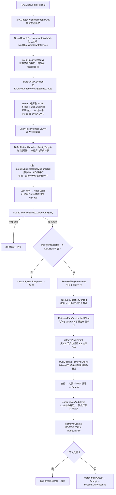
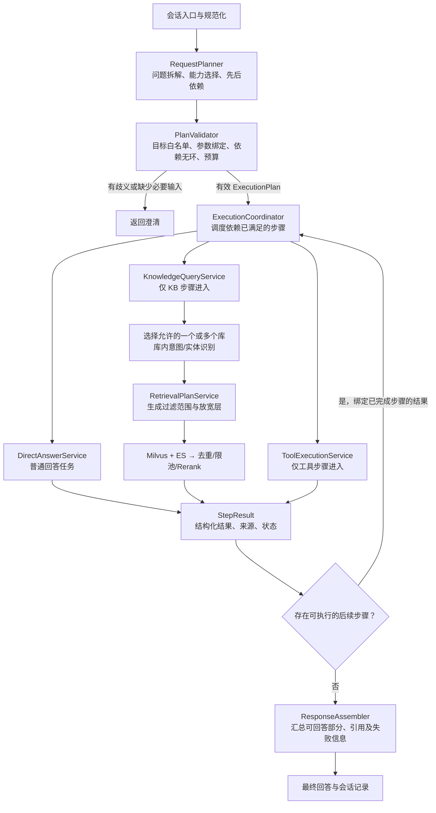

# Ragent 路由改造：现状、目标、迁移与验收

核对日期：2026-10-12。第 1 节是改造前的源码快照，第 2～4 节是设计与验收目标；不把源码注释或历史方案当成实际执行行为。WP0～WP3 第一批实施结果及当前限制见 [实施记录](G:/Ragent2026/ragent/docs/routing-refactor-wp0-wp3-2026-10-12.md)。

## 1. 当前调用链

这里将“第一层”定义为整个请求的能力选择与执行编排，“第二层”定义为 KB 内部的选库、实体、资料类型、检索过滤计划和召回。当前没有独立的第一层能力规划器，第二层的一部分提前进入了全局意图识别。



实际证据：

| 事实 | 源码入口 |
| --- | --- |
| 改写、分类、澄清、SYSTEM 特判、统一检索、空结果回复 | [RAGChatServiceImpl.java](G:/Ragent2026/ragent/bootstrap/src/main/java/com/nageoffer/ai/ragent/rag/service/impl/RAGChatServiceImpl.java:101) |
| 全局分类之前先选库，再做实体识别 | [IntentResolver.java](G:/Ragent2026/ragent/bootstrap/src/main/java/com/nageoffer/ai/ragent/rag/core/intent/IntentResolver.java:109) |
| 选库过程中已经逐个库识别实体；选择结果是单个库 | [KnowledgeBaseRoutingService.java](G:/Ragent2026/ragent/bootstrap/src/main/java/com/nageoffer/ai/ragent/rag/core/routing/KnowledgeBaseRoutingService.java:60) |
| 选定 kbId 后仅保留该 kbId 叶子，而非先做能力判断 | [DefaultIntentClassifier.java](G:/Ragent2026/ragent/bootstrap/src/main/java/com/nageoffer/ai/ragent/rag/core/intent/DefaultIntentClassifier.java:172) |
| 返回 ID 仅在全树映射中查找，未验证本次候选成员资格 | [DefaultIntentClassifier.java](G:/Ragent2026/ragent/bootstrap/src/main/java/com/nageoffer/ai/ragent/rag/core/intent/DefaultIntentClassifier.java:258) |
| KB 入口无条件执行，随后才执行当前子问题的 MCP | [RetrievalEngine.java](G:/Ragent2026/ragent/bootstrap/src/main/java/com/nageoffer/ai/ragent/rag/core/retrieve/RetrievalEngine.java:145) |
| 工具参数输入只有问题、工具定义和模板，没有 KB 结果 | [RetrievalEngine.java](G:/Ragent2026/ragent/bootstrap/src/main/java/com/nageoffer/ai/ragent/rag/core/retrieve/RetrievalEngine.java:313) |
| 搜索上下文重新计算排除库，查询 managedKbIds，未再次 route(question) | [MultiChannelRetrievalEngine.java](G:/Ragent2026/ragent/bootstrap/src/main/java/com/nageoffer/ai/ragent/rag/core/retrieve/MultiChannelRetrievalEngine.java:230) |

### 循环、重复与职责交叉

1. **没有发现“KB → 全局分类 → KB”的调用递归。** 不能把职责倒置画成不存在的无限循环。
2. **重复实体识别：** 选库时逐 Profile 调 `resolveAny`；选库后又调用一次；Plan 在实体/category 不兼容时再调用 `resolve`。后一次是有条件纠偏，不应全部删掉；应缓存同一请求中相同 `(query, kbId, allowedCategories)` 的识别结果，明确哪些重识别必要。
3. **真实检索循环：** `ProgressiveMilvusPlanRetriever.retrieve` 和 `ProgressiveKeywordEsPlanRetriever.retrieve` 分别遍历意图 Plan 和过滤层；命中停止条件或池满则退出。循环局限在 KB 内部，保留。[Milvus](G:/Ragent2026/ragent/bootstrap/src/main/java/com/nageoffer/ai/ragent/rag/core/retrieve/plan/ProgressiveMilvusPlanRetriever.java:89)、[ES](G:/Ragent2026/ragent/bootstrap/src/main/java/com/nageoffer/ai/ragent/rag/core/retrieve/plan/ProgressiveKeywordEsPlanRetriever.java:79)。
4. **纯 MCP 也可能查 KB：** `buildSubQuestionContext` 无条件调用 KB 入口；ES `isEnabled` 没有要求存在 KB 节点，当前 `fallback-when-no-intent: true`，因此在 ES 可用时纯 MCP 也可能触发 ES 搜索。向量全局通道是否启用另有 Plan 和分数条件，不是每次必跑。[ES 判断](G:/Ragent2026/ragent/bootstrap/src/main/java/com/nageoffer/ai/ragent/rag/core/retrieve/channel/KeywordEsSearchChannel.java:61)。
5. **降级改变业务边界：** 选库 LLM 异常返回 unresolved，恢复全局意图池；显式 UNKNOWN 排除托管库。两者语义不同，后续检索还重新解释排除范围。应将“无证据”“域外”“服务异常”独立建模，限定 fallback 范围。
6. **检索引擎承担协调职责：** `RetrievalEngine` 同时识别 KB/MCP 类型、构造 KB Plan、调用检索、提工具参数、并行执行工具、格式化上下文。
7. **顺序不等于依赖：** 同一子问题固定 KB 在前、MCP 在后，但 MCP 没有接收 KB 产物；不同子问题和同批 MCP 工具又全部并行。`RewriteResult` 只有问题字符串列表，无法描述依赖。
8. **结果归属丢失：** `retrieveAndRerank` 将同一份全部 Chunk 挂到每个 KB 意图；汇总 `intentChunks.putAll` 可能覆盖不同子问题相同意图的结果。新结果应保留步骤、子问题、库和来源归属。
9. **意图混合的回答路径不完整：** 仅“所有子问题都 SYSTEM-only”才走普通回答；SYSTEM 与 KB/MCP 混合时，SYSTEM 不形成独立任务。所有检索/工具结果为空则统一回复未找到文档，不能区分工具失败、知识为空和仍可回答的普通部分。

## 2. 目标调用链与职责



图中的回边是协调器执行步骤的循环。**任务依赖图必须无环**，每一步最多按明确重试策略执行；默认没有“结果不好就再次全局路由”的无限自我规划。确需后续重新规划时，作为独立、受预算约束的扩展，初次迁移不实现。

| 角色 | 应承担的职责 | 边界 |
| --- | --- | --- |
| RequestPlanner | 将请求变成有限步骤，指定能力及依赖；明确目标时填写目标，否则交给能力服务局部选择 | 不读 Chunk、不调用 MCP、不生成 ES/Milvus 过滤层 |
| PlanValidator | 校验已注册/有权限的目标、参数引用、无环依赖、步骤及调用预算 | 规划器的输出不能直接驱动外部执行；结构化输出后仍要验证 |
| ExecutionCoordinator | 等待前置结果、绑定参数、并行独立步骤、处理超时/取消/失败传播 | 不识别实体、不选择资料类型、不提取模型 Prompt |
| KnowledgeQueryService | 校验 KB 范围，必要时选库，库内识别实体和资料类型，构建 RetrievalPlan，调用召回/排序 | 不调用 MCP、不决定全局业务流程、不跨允许库偷偷 fallback |
| ToolExecutionService | 对指定工具校验参数、调用执行器、返回业务结构化结果；必要时局部选择工具 | 不查询 KB、不重新决定全局能力；参数中的依赖值来自绑定结果 |
| ResponseAssembler | 按步骤结果汇总、生成引用、表达部分失败，必要时调用最终 LLM | 不发起新的检索或业务工具调用 |

`ExecutionPlan` 与现有 `RetrievalPlan` 必须分开：前者规划业务步骤和依赖；后者只规划 KB 检索范围。

拟议接口：

```java
ExecutionPlan RequestPlanner.plan(RequestContext request, CapabilityCatalog catalog);
ValidatedPlan PlanValidator.validate(ExecutionPlan plan, RequestContext request);
ExecutionResult ExecutionCoordinator.execute(ValidatedPlan plan, RequestContext request);
KnowledgeResult KnowledgeQueryService.query(KnowledgeQuery query);
ToolResult ToolExecutionService.execute(ToolInvocation invocation);
AnswerResponse ResponseAssembler.assemble(RequestContext request, ExecutionResult result);
```

这些是目标接口草案，第一批实现的签名以源码为准。当前使用普通 Spring Service，不引入 Spring AI Alibaba Graph。复杂依赖与参数绑定留待基础路径验收后扩展。

### 必需的数据契约

- `PlanStep`：`stepId`、`capability`、`query`、可选目标、`dependsOn`、`inputBindings`、失败策略。
- `KnowledgeQuery`：查询、允许库范围、权限上下文、TopK、请求和步骤标识；不能传入混合 SYSTEM/MCP/KB 的全局结果。
- `KnowledgeResult`：每个 Chunk 保留 `kbId`、来源与引用标识、对应步骤/查询；score 仅用于对应检索阶段排序，跨库合并策略要明确。
- `ToolInvocation`：指定工具、解析后的参数、权限上下文和步骤标识；已绑定的上游值不得由 LLM 重新猜写。
- `StepResult`：`stepId`、状态、结构化数据、证据、耗时、错误原因。区分成功、无结果、失败、阻塞、取消。

### 依赖示例

以下工具都是验收测试桩，不假定当前 MCP 已提供这些业务接口。

```text
s1：TOOL 查询订单 → 输出 productId、purchaseDate
s2：KB 检索该商品保修条款
    dependsOn = [s1]
    entity/product 输入绑定 s1.productId
s3：DIRECT 综合订单日期和条款判断
    dependsOn = [s1, s2]
```

反向依赖也要支持：KB 先提取某条款需要的参数，随后 TOOL 使用该结构化结果。依赖值必须能从产物中定位；若提取需要 LLM，应为显式步骤并保留证据，不能让协调器隐式创造业务字段。

多知识库允许一个 KB 步骤检索多个指定库，也允许多个独立 KB 步骤；某一步路由仍不明确时澄清，不能为了返回唯一库而丢掉跨库需求。

## 3. 迁移方案

| 现有组件 | 处理方式 |
| --- | --- |
| RAGChatController、会话记忆、SSE 回调、任务取消 | 保留外部接口，入口逐步转为 Planner → Coordinator → Assembler |
| QueryTermMappingService | 保留规范化；移除与能力选择耦合 |
| MultiQuestionRewriteService | 保留兼容入口；拆分职责逐步移到 Planner，避免改写拆分和业务规划各做一次 LLM 拆解 |
| IntentResolver | 旧路径短期保留；新入口不再用它协调全局能力；KB 局部识别拆成专用接口 |
| KnowledgeBaseRoutingService、ProfileRegistry、EntityResolver | 保留规则与实体证据，只在 KB 服务内使用；route 从单库结果扩展到可表达多库/歧义/失败的结果 |
| DefaultIntentClassifier、IntentHybridRecallService | 保留库内资料类型匹配；候选必须属于允许库和 KB 类型；返回 ID 必须属于本次 shortlist，父节点/域外节点不能通过 |
| RetrievalPlanService、IntentRouteRuleService、逐级检索器 | 保留为 KB 内部执行计划；实体重识别条件明确；实体兜底必须绑定本次允许库，不能随全局配置跳库 |
| MultiChannelRetrievalEngine、SearchChannel、后处理器 | 保留；输入改为 KB 专用上下文；routed/excluded 范围由 KB 服务统一给定 |
| RetrievalEngine | 拆成 KnowledgeQueryService、ToolExecutionService、结果组装；旧类短期作为兼容适配器，最终删除跨能力协调职责 |
| MCPToolRegistry、MCPClient、MCPToolExecutor | 保留；工具目录可供规划器读取名称、描述和参数定义，执行只由工具服务负责 |
| LLMMCPParameterExtractor | 保留处理用户自由文本；增加已绑定参数优先级与 Schema 校验，不允许覆盖前置结果 |
| ContextFormatter、RAGPromptService | 保留展示和 Prompt 模板，改为消费有归属的步骤结果；整理为 ResponseAssembler 的内部组件 |
| ModelSelector、RoutingLLMService、模型降级 | 保留。这是模型供应商路由，不参与业务能力和知识库导航决策 |
| MetadataRetrievalEvaluationService | 改为走独立 KB 接口，继续比较 KB 策略，不能为了评测绕回旧全局意图入口 |

新路径应删除或移走的具体调用：

1. 删除全局 `IntentResolver.classifySubQuestion` 的 `knowledgeBaseRoutingService.route(question)` 和 `entityResolver.resolveAny`；移入 KB 服务。
2. 删除以“选出的单个 kbId”过滤所有能力节点后再判断 SYSTEM/MCP/KB 的链路。
3. 删除 `RetrievalEngine.buildSubQuestionContext` 无条件调用 KB 的行为；只有 KB 步骤能执行检索。
4. 从检索引擎移走 `executeMcpTools`、`buildMcpRequest` 与工具线程调度。
5. 移走 `MultiChannelRetrievalEngine.resolveExcludedKbIds` 对路由决策的二次解释；引擎仅消费明确范围。
6. 替换“所有子问题并行”和“所有工具并行”的默认调度：先检查依赖，只并行就绪步骤。
7. 不再用“所有子问题都 SYSTEM-only”作为普通回答的唯一开关；普通回答可以是混合计划中的步骤。

逐步落地：

- WP0：固定当前基线，补候选越界、纯 MCP 触发 KB、混合结果归属的失败用例。
- WP1：抽出 KB/工具接口，旧入口委托它们；保持旧接口可用，先验证职责拆分。
- WP2：增加 ExecutionPlan/验证器/协调器，使用固定测试计划验证 DAG 和参数传递，不依赖真实 LLM。
- WP3：接入 Planner，普通/KB/MCP/多库/混合路径通过行为验收后切换新入口。
- WP4：小样本真实模型评测和受控故障测试，通过后停用旧全局路由；切换标志放在请求入口，每个请求选定一条路径。
- WP5：迁移评测与其他调用者，删除确认无引用的旧协调方法。

新旧对照期间可比较规划结果；**工具执行不双跑**。切换失败也不在工具已执行后自动整请求重放；恢复旧入口只影响后续请求。异步失败重试由明确策略控制，涉及写操作需幂等机制。

## 4. 测试与完成判定

### 程序行为测试：固定规划结果、模拟模型/KB/MCP

| 场景 | 预期行为与关键断言 |
| --- | --- |
| 普通问答：“你好，介绍下自己” | DIRECT；KB 导航、实体目录、意图海选、ES、Milvus、MCP 全部零调用 |
| 纯 KB：“神里绫华的技能是什么” | 只执行 KB；库/实体/过滤范围正确，工具零调用，有可归属引用 |
| 纯 MCP：“查询指定工单状态” | 只执行工具；KB 服务、ES/Milvus、Rerank 零调用，参数符合工具定义 |
| 多知识库：“分别查商品规格和原神角色技能” | 两个 KB 范围都执行，不被单库路由截断；结果带各自库标识，不泄漏第三库 |
| 无依赖 KB+MCP | 两步骤可以并行；用 latch/barrier 验证二者均能在对方释放前启动，不能只测总耗时 |
| MCP → KB | 前置工具完成前 KB 不启动；KB 查询/过滤中的产品值等于前置结果 |
| KB → MCP | KB 未完成前工具不启动；工具参数等于绑定结果，LLM 参数提取不能覆盖 |
| MCP → MCP | 第二工具等待第一工具，准确传递 ID，执行一次；不存在无条件同批并行 |
| 多前置依赖汇合 | 下游等待所有 required 依赖成功；已完成的独立分支不重复执行 |
| DIRECT+KB 混合 | 普通部分保留；KB 空结果时仍表达普通部分和资料缺失 |
| UNKNOWN/缺少实体或工具参数 | 明确澄清或 NO_MATCH，不静默跨库检索、猜参数或调用错误工具 |
| 候选越界 | 全树中存在但不在本次 shortlist 的 ID、父节点、其他 kind/库的节点全部拒绝 |
| 非法计划 | 未知工具、无权限库、缺失依赖、环依赖、重复 stepId、无效绑定、超预算均在执行前拒绝 |
| 前置失败 | 依赖步骤 BLOCKED，零调用；独立分支按策略继续，最终标明部分失败 |
| 前置无结果 | 与失败区分；required 数据缺失不执行下游，也不伪造默认参数 |
| 超时、取消、重试 | 未启动步骤不再执行；活动调用尽力取消；迟到结果不污染新任务；写工具不隐式重放 |
| KB 放宽与故障降级 | 全部过滤层及 legacy fallback 均保持允许库边界；ANY_HIT 命中即停；一个通道失败时不静默变成跨库 |
| Chunk 归属与同名意图 | 不把所有 Chunk 复制给每个意图；不同步骤/库的同名意图不互相覆盖；引用指向真实来源 |

未来建议的测试类：`RequestPlannerTest`、`ExecutionPlanValidatorTest`、`ExecutionCoordinatorTest`、`KnowledgeQueryServiceTest`、`ToolExecutionServiceTest`、`RAGWorkflowAcceptanceTest`。这些尚未新增，不把计划中的测试计为已通过。

### 模型效果与真实系统测试

固定一份问题集，逐项标注能力、允许目标、依赖和预期证据。独立记录能力选择、选库、参数绑定和来源正确性；同时记录实际节点执行序列、模型调用次数、Token、各阶段耗时、失败和降级原因。真实模型输出偶然正确不替代程序行为断言，模拟行为测试通过也不替代模型效果评测。

KB 验证可接入当前 ES/Milvus 小样本；工具使用受控测试服务器或只读工具。没有承诺未测过的准确率、延迟或成本阈值；上线前根据固定基线和需求确定门槛。

### 本轮实际验证

运行以下现有测试类：`DefaultIntentClassifierStrategyTest`、`KnowledgeBaseRoutingServiceTest`、`RetrievalPlanServiceTest`、`ProgressiveMilvusPlanRetrieverTest`、`ProgressiveKeywordEsPlanRetrieverTest`、`CandidatePoolLimiterPostProcessorTest`。

结果：31 项通过，失败 0，错误 0。它们提供现有组件基线，尚不覆盖新的能力隔离、依赖执行和完整多库工作流，不能据此宣称改造完成。

完成标准：新入口所有上述行为场景通过；测试证明普通/纯工具零 KB 调用；依赖绑定与失败传播可复现；真实问题评测达成约定门槛；评测及其他调用者迁移；旧入口确认停用；SSE、会话记录、取消和模型降级保持可用。
